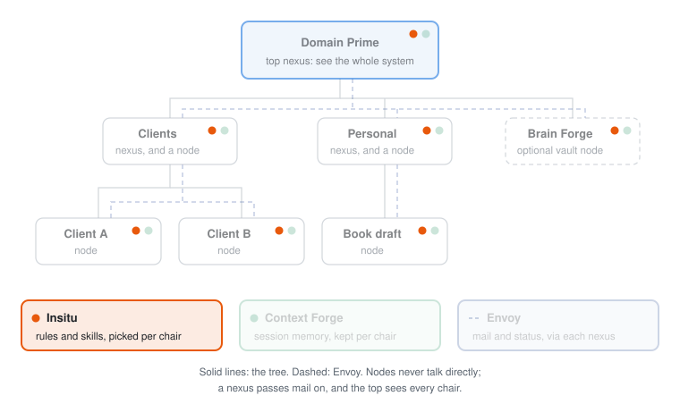

# Insitu

Insitu keeps your AI instructions and skills in one vault, and every project subscribes to exactly the set it needs, so guidance stops drifting between projects.

## The problem

You already have directions for how an agent should work with you. The pain is reuse. The same guidance needs to show up in more than one place, but not the same set every time. Copies drift. A new repo starts without the ones you meant to bring. You notice after the agent has already gone the wrong way.

## What you get

- **Write it once.** Each piece of guidance is one markdown file in one vault. Fix it there and every project that uses it gets the fix.
- **A deliberate set per project.** Each project picks its own mix: always-loaded guidance, guidance pulled only when the work needs it, bundled roles, and `/name` skills. Not a paste of everything.
- **Every AI client, its own format.** Insitu writes the project's set into the files each client already loads. Name the clients you use once, and every project adapts to each.
- **Guardrails on shared rules.** A rule that other projects depend on can't be quietly edited from inside one project.
- **A size check.** Reports tell you when a project's loaded guidance has grown heavier than it should be.

## A day with it

This walks through the sample vault that ships in [`examples/vault`](examples/vault), with two made-up repos, `harbor-notes` and `river-ledger`.

Each repo carries a different set from the same vault. `summary-first`, how the agent reports back, is global guidance: `river-ledger` takes it, `harbor-notes` opts out. `small-diffs` is always loaded in `harbor-notes` but only on demand in `river-ledger`. `river-ledger` also wears the `clerk` role for its bookkeeping guidance and maps a `/close-books` skill that `harbor-notes` never sees.

In the morning you ask the agent in `river-ledger` to materialize. Insitu writes the composed set into the files your AI client loads, and copies `/close-books` into that client's skill folder. Switch clients after lunch and the same set is waiting there, in that client's format.

Late in the day you decide `small-diffs` should be stricter. You edit the one article in the vault, and each repo that carries it picks up the change the next time it materializes. With operators set up, an attempt to make that edit from inside `harbor-notes` is refused, because `river-ledger` composes the article too.

## Part of Domain Prime

<picture>
  <source media="(prefers-color-scheme: dark)" srcset="docs/domain-prime-dark.svg">
  
</picture>

Insitu is one of four engines in [Domain Prime](https://github.com/srmackey/domainprime), a local-first system for running many AI projects as a tree. Every chair in the tree, the top included, can subscribe to its own set of instructions from one shared vault. It also runs on its own: point it at any folder and it works without the rest. Terms like chair and nexus are defined in the [glossary](https://github.com/srmackey/domainprime/blob/main/docs/glossary.md).

## How it works

Insitu is a portable MCP server. One vault holds the reusable pieces of how an agent should work with you. A project map names which of those pieces apply in this folder. The server composes them into a protocol and writes that core into files the host already loads.

It is not a wiki, not a bulletin, and not a model of a codebase. It does not run git and it does not use the network.

The vault holds five kinds of thing:

- **Articles.** Standing guidance (tone, method, review, identity that changes how the agent operates). One markdown file each.
- **Roles.** Named packs of articles and skills a kind of project includes as a unit (`node`, `repo`, and the like).
- **Projects.** A map per working folder: core articles, on-demand articles, imported packs, and skills.
- **Skills.** Procedures the host should expose as `/name`. Carried by a role or mapped on the project. Copied into host skill directories on `materialize`. Not concatenated into the protocol.
- **Packs.** Versioned capabilities authored outside the vault. Each Domain Prime product ships one as its public contract (insitu-core, envoy, context-forge, brain-forge). Installed onto a shelf, then imported by a project.

How they fit together:

- An **article** is one markdown file of standing guidance.
- A **role** is a named, ordered pack of articles and skills a project can include as a unit.
- A **project map** selects articles as core (always loaded) or on-demand (pulled when the work needs them), plus imported packs and mapped skills.
- A **protocol** is composed, never a catalog row. `materialize` writes `PROTOCOL.md` plus host adapters so the core is in the session. `resolve_protocol` inspects the same composition.
- A **skill** is a procedure the host discovers as `/name`. `materialize` copies composed skills into the project skill directory each enabled host names in `platforms.yaml`. With no environment file, no skill directory is created.
- A **pack** is a versioned bundle on the vault shelf (`library/<id>/<version>/`). `install_capability` / `install_article` pull it and write this map. A single-article install may land in `core` or `on_demand`.

Size reports on articles and on the composed protocol tell you when to trim. Skills have their own size summary. They do not go into the protocol token count.

## Install

Requires Python 3.11+ and [uv](https://docs.astral.sh/uv/).

```bash
git clone https://github.com/srmackey/insitu.git
cd insitu
uv sync
uv run pytest
```

`uv run insitu` starts the server on stdio through FastMCP 2. There is no published package. Clone and run from the checkout.

### Vault

One vault per process, resolved in this order:

1. `INSITU_HOME`
2. `--vault /path/to/vault`
3. `~/.insitu`

A vault is folders on disk (`articles/`, `skills/`, `provenance/`, `projects/`, optional `roles/`, `library/`, and `config/`). This repo ships a sample vault:

```bash
uv run insitu --vault examples/vault
```

Keep a personal vault outside the checkout.

### Add the server

The procedure is [`install/README.md`](install/README.md). The block is [`install/mcp.json.examples.md`](install/mcp.json.examples.md). Host files come from `platforms.yaml` next to `nexus.md`. With no environment file, user-global host config is left alone, and project instructions land on `agents` through `materialize`.

```yaml
command: uv
args: ["run", "--directory", "/path/to/insitu", "insitu"]
env:
  INSITU_HOME: /path/to/your/vault
```

A router tells the host that Insitu exists. It is not the project protocol. The install pass places it from `install/routers/`. Optional: paste `install/AGENTS.md` into a constitution file by hand. `materialize` never writes `CLAUDE.md` or `CLAUDE.local.md`. It writes the project `AGENTS.md` only when that file is missing or already carries the Insitu stamp, which is what a checkout gets when `platforms.yaml` is absent.

When `INSITU_ROOT` points at a folder with `nexus.md` and `platforms.yaml`, `enabled` in that file chooses the hosts, and each stored definition says where the adapter and the skills go. From an existing project checkout, call `materialize`. That writes `PROTOCOL.md`, one adapter for each definition it can apply, and skill copies into each project skill path that definition names. A missing environment file writes `AGENTS.md` (when Insitu may own that file) and does not invent host skill trees. If the folder is missing, the call is refused (`working_folder_missing`); it does not create one.

## Working with an agent

Once the server, vault, and router are in place, you talk to the agent in the project folder. Outside an install, Insitu keys the project off that folder's name. When `INSITU_ROOT` points at a folder with `nexus.md`, the key is the address from that file.

**First time in a checkout.** Ask the agent to materialize this project's protocol. That writes `PROTOCOL.md`, the host adapter files, and mapped skill copies. With no `platforms.yaml`, the adapter is `AGENTS.md` when that file is missing or already stamped. `CLAUDE.md` is not that output. Later sessions load the core on their own. Do not edit the generated protocol or skill files. Change an article, skill, or the project map in the vault, then materialize again.

**Day to day.** The core is already in the session. Treat it as binding. Mapped skills are already in the host skill directories; treat `/name` as binding. Some articles are only *on-demand*: listed, not loaded. When the work needs one, ask the agent to pull it. You can name the guidance ("use summary-first") instead of a path.

**A new project.** Ask what articles, roles, skills, and packs exist. Pick the set this project should carry. Install a capability if this folder should use a whole pack. Then materialize. The point is a deliberate subset, not a paste of everything.

**When something feels off.** If the protocol is missing, stale, or heavier than it should be, ask the agent for Insitu status of this folder (`project_status`) or to inspect the composition and the size report. Rematerialize after you trim or change membership.

**Add or update.** If you find yourself repeating instructions, name and create a new article (or a skill, if it should be a `/name` procedure). Link it to one or more roles or projects. Instructions not working as expected? Find the articles or skills in use and update the right one.

## Tools

Forty-five tools. The list, the hint set on each one, and what it returns are in [docs/tools.md](docs/tools.md).

On initialize the server returns a short operating note: session start is `resolve_protocol` to inspect, and `materialize` writes the composed protocol. That note lives in the server. This page does not repeat it.

Every mutating tool takes `working_folder`. A **bound** chair (the default) may
write only its own map. Outside an install that key is the folder's basename.
When `INSITU_ROOT` points at a folder with `nexus.md`, the key is the address
from that file, and a unique basename still resolves. An **admin** chair may
name another key in its scope: any key for the top nexus, and its own address
plus the addresses under it for any other admin.

Articles, roles, and skills belong to no single map, so they are gated by reach
instead: creating is always allowed, and editing or deleting one is refused once
a map other than yours composes it. Editing a role is the sharp case, since its
membership reaches every map that carries it. A vault with no
`config/operators.yaml` runs pre-init: writes go through as before and the
result says how to fix it.

```
insitu init --admin <project-key>   # register the first admin; refuses if one exists
insitu operators                    # show the config
insitu                              # start the MCP server (unchanged)
```

## Trust boundary

- Transport is stdio. The host starts a local process as the user who launched it.
- The process reads and writes the vault (`INSITU_HOME`, or `~/.insitu`).
- `materialize` also writes generated files into the working folder the caller names, and only when that folder already exists.
- It does not run git, it does not start a shell, and it does not use the network.
- It does not take a credential.

The same boundary, and how to report a vulnerability, is in [SECURITY.md](SECURITY.md). How the system is structured is in [DESIGN.md](DESIGN.md). What moved between versions is in [CHANGELOG.md](CHANGELOG.md).

## Develop

```bash
uv sync
uv run pytest
uv run insitu
```

## License

MIT. See `LICENSE`.
